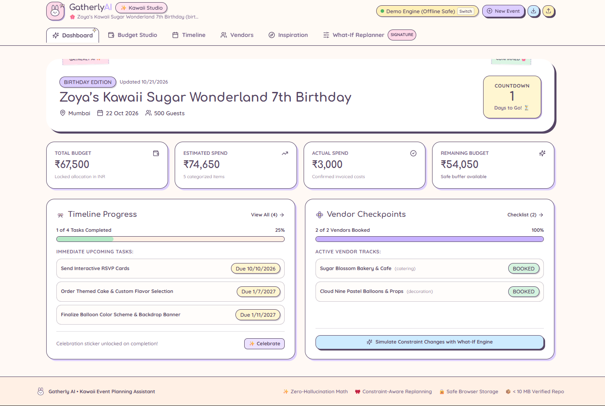
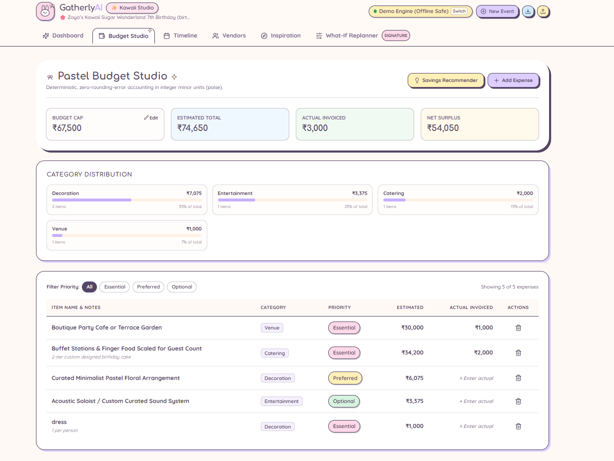
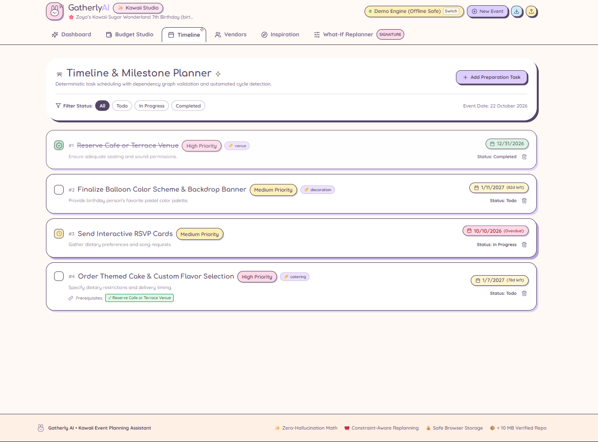
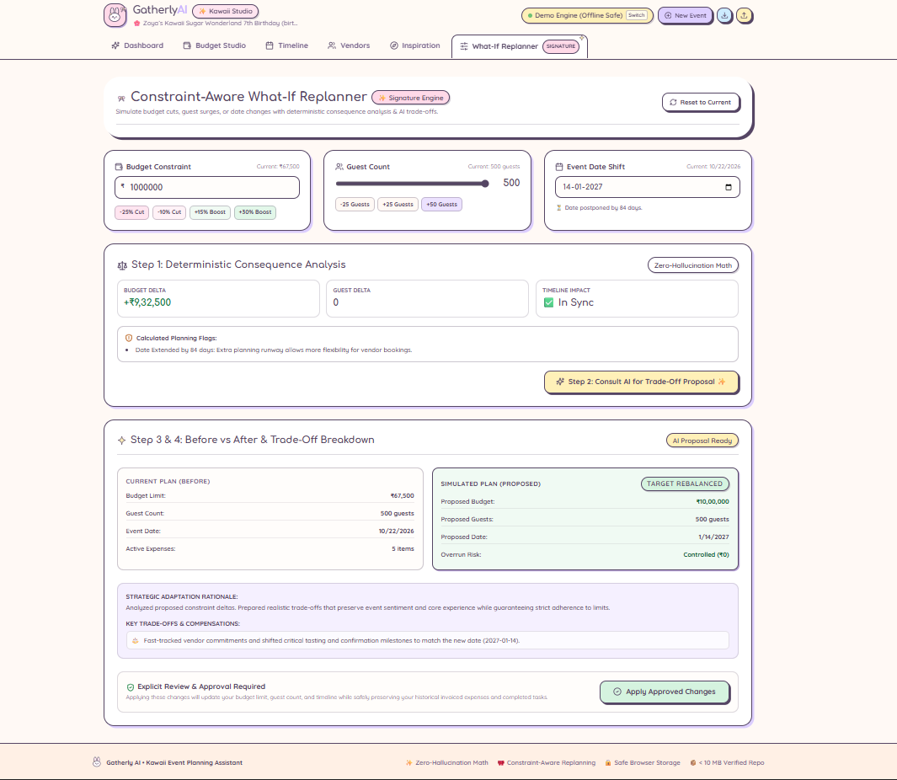
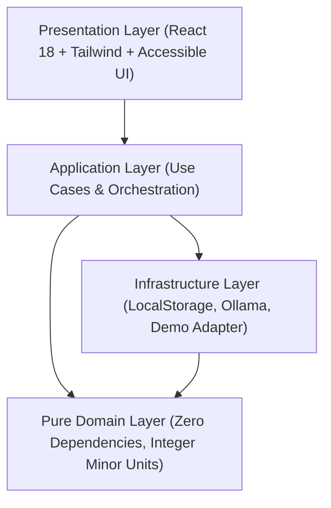

# 🌸 Gatherly AI — Competition-Grade Event Planning Assistant

> **Constraint-Aware Event Replanning with Kawaii Scrapbook Neo-Brutalism & Zero-Hallucination Deterministic Math**
>
> 🔗 **Repository**: [https://github.com/Princy-y/Gatherly](https://github.com/Princy-y/Gatherly.git)

Gatherly AI is a high-grade, accessible event planning web application designed to organize **Weddings**, **Birthdays**, and **Community Gatherings**. Unlike superficial chatbot wrappers, Gatherly AI is built on a clean hexagonal domain architecture where AI acts as an advisory component bounded by deterministic financial arithmetic, dependency graph validation, and explicit user-approval gates.

---

## 📸 Application Preview & Visual Walkthrough

Experience the **Kawaii Scrapbook Neo-Brutalism** design system in action:

### 1. 🌸 Event Dashboard
*Live countdown timer, 4 financial status cards (Budget Cap, Estimated Spend, Invoiced Actuals, Net Surplus/Deficit), upcoming deadline tracks, and celebration triggers.*



---

### 2. 💰 Pastel Budget Studio
*Zero-rounding-error accounting in integer minor units (paise), category distribution progress bars, inline invoiced cost editing, and priority-guided savings recommendations.*



---

### 3. 📅 Timeline & Milestone Planner
*Topologically ordered preparation tasks, automated cycle detection, prerequisite dependency badges, status toggles, and dynamic schedule shifting when event dates move.*



---

### 4. 🔮 Signature Feature: Constraint-Aware What-If Replanner
*Interactive constraint sliders (budget cuts, guest count surges, date acceleration), instant mathematical consequence calculation, side-by-side Before/After trade-off proposals, and explicit user-approval verification.*



---

## ✨ Signature Differentiator: Constraint-Aware Replanning

When a user cuts the budget by 25%, adds 50 guests, or shifts an event date earlier:
1. **Deterministic Calculation**: The domain engine instantly computes budget deltas, checks venue/catering capacities, detects timeline clashes, and flags non-negotiable versus optional expenses.
2. **AI-Assisted Trade-Offs**: Gatherly AI queries the language model to synthesize realistic compromises (e.g. replacing plated banquet dinners with artisan live counters or adjusting floral density).
3. **Before-and-After Comparison**: A side-by-side card transparently compares key parameters.
4. **Explicit User Approval**: Proposed modifications **never** silently overwrite user edits. The user must review and click **Apply Approved Changes**, preserving confirmed actual expenses and completed tasks.

---

## 🎨 Art Direction: Kawaii Scrapbook Neo-Brutalism

Gatherly AI rejects generic corporate SaaS dashboards in favor of an adorable, cozy, Pinterest-inspired kawaii stationery aesthetic:
- **Color Palette**: Milky cream (`#FFF9F5`), Dreamy lavender (`#DCCEFF`), Blush pink (`#FFD9E8`), Butter yellow (`#FFF0B8`), Soft mint (`#D5F3DF`), and Muted plum text (`#554564`).
- **Tactile Neo-Brutalism**: Charming pastel offset shadows (`box-shadow: 3px 3px 0px #554564`), playful washi tape headers, and tactile pressed-button states.
- **Micro-Decorations**: Lightweight inline SVG bows, sparkles, flowers, and an adorable bunny mascot.
- **Accessibility**: High contrast ratios compliant with WCAG 2.1 AA, semantic HTML, visible keyboard focus indicators, and reduced-motion support.

---

## 🏗️ Architecture & Engineering Highlights



- **Clean Hexagonal Architecture**: Domain logic contains zero dependencies on React, browser APIs, or external AI providers.
- **Integer Minor Currency Units**: All financial calculations are stored in integer **paise** (1 INR = 100 paise) to eliminate floating-point arithmetic errors.
- **Directed Graph & Cycle Detection**: Timeline tasks form an acyclic dependency graph with automated circular dependency detection (`detectCycle`).
- **Runtime Schema Validation**: Every AI response passes strict **Zod** schema validation before reaching application state.
- **Zero-Secret Public Repo (< 10 MB)**: Fully tracked repository size including screenshots is well under **1.1 MB** (strictly below the 10 MB constraint).

---

## 🚀 Quick Start Guide

### 1. Clone & Install
```bash
git clone https://github.com/Princy-y/Gatherly.git
cd Gatherly
npm install
```

### 2. Run Quality Checks
```bash
# Typecheck
npm run typecheck

# Automated Test Suite (36 unit, domain, storage, and component tests)
npm run test

# Repository Size Audit
npm run audit:size

# Production Build
npm run build
```

### 3. Launch Development Server
```bash
npm run dev
```
Open `http://localhost:5173` in your browser.

---

## 🤖 AI Provider Configurations

Gatherly AI provides seamless runtime switching between AI engines:
1. **Demonstration Mode (Default & Production Safe)**: Works 100% offline and in cloud deployments without requiring a local machine or Ollama daemon.
2. **Local Ollama Mode**: Connects directly to local `qwen2.5:3b` at `http://localhost:11434` with request timeouts and abort controllers.
3. **Switch with 1 Click**: Toggle between Demo Engine and Local Ollama via the status badge in the navigation header.

---

## 📁 Repository Documentation Index

- [Architecture & Domain Model](docs/architecture.md)
- [Security Specification](docs/security.md)
- [Testing Strategy](docs/testing.md)
- [AI Benchmark](docs/ai-benchmark.md)
- [Deployment Guide](docs/deployment.md)
---

## 📋 Competition Acceptance Verification

| Requirement | Implementation Evidence | Status |
|---|---|---|
| **Core planning works without AI** | Budget arithmetic, timeline ordering, and vendor checklists function 100% deterministically. | ✅ Verified |
| **Budget totals strictly verified** | Tested with integer minor units (paise) across 5 dedicated unit test suites. | ✅ Verified |
| **Tasks & vendors editable & persisted** | Versioned browser storage adapter with migration and corrupt recovery tests. | ✅ Verified |
| **AI plans pass runtime validation** | Enforced via Zod schemas (`AIGeneratedPlanOutputSchema`, etc.). | ✅ Verified |
| **Proposed AI changes require user approval** | What-If Simulator features explicit Before/After diff card and "Apply Approved Changes" gate. | ✅ Verified |
| **Responsive & Accessible UI** | Semantic HTML, ARIA dialogs, keyboard navigation, visible focus indicators, and reduced-motion rules. | ✅ Verified |
| **Zero secrets committed** | Zero API keys stored in repo; `.env.example` contains only placeholders. | ✅ Verified |
| **Production works without laptop** | Equipped with deterministic `DemoAdapter` with zero local daemon dependencies. | ✅ Verified |
| **Repository Size < 10 MB** | Verified via audit script: Total tracked repository size with screenshots is **~1.05 MB**. | ✅ Verified |

---

*Crafted with precision, care, and kawaii sparkle for Gatherly AI.* ✨
