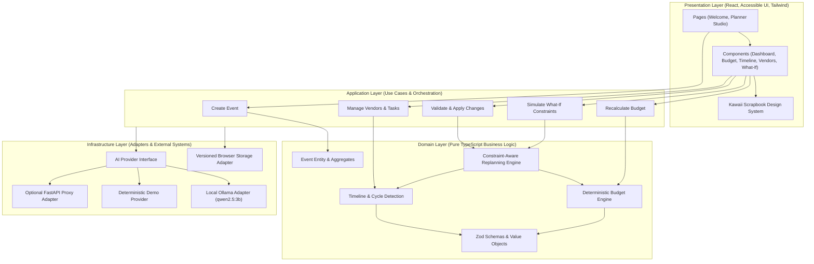

# Gatherly AI — Architecture & Engineering Specification

## 1. Architectural Overview & Separation of Concerns

Gatherly AI separates presentation components, application use cases, domain logic, and infrastructure adapters.

**Architecture principle:** Core business rules should remain independent of UI frameworks and external AI providers. Infrastructure integrations should be accessed through clearly defined interfaces.

---

## 2. Layer Definitions & Strict Rules

1. **Domain Layer (`src/domain/`)**:
   - Pure, deterministic business logic and rules.
   - Zero dependencies on React, browser APIs, or external AI endpoints.
   - **Financial Arithmetic**: Conducted exclusively in integer minor units (paise for INR: 1 INR = 100 paise) to avoid floating-point inaccuracies.
   - **Timeline & Graph Engine**: Directed graph with topological sorting and cycle detection (`detectCycle`, `getTopologicalOrder`) to prevent invalid task dependencies.
   - **Constraint Re-planner**: Deterministically computes delta consequences of guest count adjustments, budget slashes, or date shifts before any AI suggestion is requested.

2. **Application Layer (`src/application/`)**:
   - Use cases and state management orchestration.
   - Connects user intents to domain logic and infrastructure adapters.
   - Validates all external inputs (including AI outputs) using Zod runtime schemas before modifying application state.

3. **Infrastructure Layer (`src/infrastructure/`)**:
   - `StorageAdapter`: Handles schema versioning, automated migrations, record validation, and graceful recovery from corrupt state.
   - `AIProvider`: Abstraction defining `generatePlan`, `revisePlan`, and `generateInspiration`. Implementations include `OllamaAdapter` (connecting to `qwen2.5:3b` with timeout and abort support) and `DemoAdapter` (ensuring 100% production functionality without a local machine running).

4. **Presentation Layer (`src/presentation/`)**:
   - Kawaii Scrapbook Neo-Brutalism design system.
   - Adorable, tactile, accessible components adhering to WCAG 2.1 AA.
   - No duplicated domain calculations; relies strictly on domain outputs.

---

## 3. Data Integrity & Minor Currency Units

- Currency: **INR (₹)** as base currency.
- Storage: **Paise** (Integer minor units, 100 paise = 1 INR).
- Calculations:
  - Estimated Total = $\sum \text{expense.estimatedCostPaise}$
  - Actual Total = $\sum \text{expense.actualCostPaise}$
  - Remaining Budget = $\text{budgetLimitPaise} - \text{actualTotal}$
  - Overrun = $\max(0, \text{actualTotal} - \text{budgetLimitPaise})$

---

## 4. What-If Constraint-Aware Replanning Workflow

1. User proposes constraint changes (e.g. Budget -20%, Guest count +50, Event date moved earlier).
2. **Step 1 (Deterministic)**: The Domain Constraint Engine computes math deltas:
   - Identifies impossible task due dates (due date > new event date).
   - Identifies budget overruns and per-guest category changes (catering, venue capacity).
   - Flags non-negotiable / essential expenses versus optional items.
3. **Step 2 (AI Proposal)**: The AI Provider is queried with the exact diff context to produce creative trade-offs (e.g., swapping plated dinners for high-end food stations, adjusting venue floorplans).
4. **Step 3 (Validation & Review)**: Proposal passes strict Zod validation. The UI presents a side-by-side **Before vs After** comparison card with explicit trade-off explanations.
5. **Step 4 (Explicit User Approval)**: Changes are **never** silently applied. The user must review and click "Apply Approved Changes". User-confirmed actual costs and completed tasks are permanently preserved.
