# Gatherly AI — Automated Testing Strategy & Verification Report

## 1. Test Architecture & Coverage Matrix

Gatherly AI implements an automated testing strategy spanning Domain Unit Tests, Infrastructure Integration Tests, Component Interaction Tests, and End-to-End Playwright specs.

```mermaid
graph TD
  UnitTests["Domain Unit Tests (Vitest)"] --> Currency["Minor Units (Paise) Conversion"]
  UnitTests --> Budget["Deterministic Budget Arithmetic"]
  UnitTests --> Graph["Topological Order & Cycle Detection"]
  UnitTests --> Constraints["Constraint Simulation Deltas"]

  IntegTests["Integration Tests (Vitest)"] --> Storage["Storage Migrations & Corruption Recovery"]
  IntegTests --> AI["AI Schema Validation (Zod)"]

  CompTests["Component Tests (React Testing Library)"] --> AppComp["App Full Navigation"]
  CompTests --> BudgetComp["Budget Studio Inlined Actuals & Add Expense"]
  CompTests --> WhatIfComp["What-If Replanner Review & Approval Flow"]

  E2ETests["E2E Tests (Playwright)"] --> Walkthrough["Full Planning & Persistence Lifecycle"]
```



---

## 2. Test Execution Commands

| Suite | Command | Environment | Scope |
|---|---|---|---|
| **Unit & Component Tests** | `npm run test` | Node.js (Vitest + JSDOM) | 36 Automated Tests across 9 Suites |
| **Typecheck** | `npm run typecheck` | TypeScript 5.6+ (Strict Mode) | Zero compiler errors |
| **Production Build** | `npm run build` | Vite Bundler | Bundles into ~350KB JS, ~26KB CSS |
| **Repository Size Audit** | `npm run audit:size` | Node.js | Strict verification against < 10 MB limit |
| **End-to-End Testing** | `npm run test:e2e` | Playwright Chromium | Critical multi-tab user journey |
| **Live AI Benchmark** | `node scripts/benchmark-ollama.mjs` | Node.js + Ollama | Real inference evaluation on `qwen2.5:3b` |

---

## 3. Verified Test Suite Results

```
 RUN  v2.1.9 D:/Gatherly

 ✓ src/domain/__tests__/timeline.test.ts (6 tests)
 ✓ src/domain/__tests__/currency.test.ts (4 tests)
 ✓ src/domain/__tests__/budget.test.ts (5 tests)
 ✓ src/infrastructure/storage/__tests__/localStorageAdapter.test.ts (5 tests)
 ✓ src/domain/__tests__/constraints.test.ts (3 tests)
 ✓ src/infrastructure/ai/__tests__/aiAdapters.test.ts (4 tests)
 ✓ src/presentation/__tests__/BudgetStudioTab.test.tsx (3 tests)
 ✓ src/presentation/__tests__/WhatIfSimulatorTab.test.tsx (3 tests)
 ✓ src/presentation/__tests__/App.test.tsx (3 tests)

 Test Files  9 passed (9)
      Tests  36 passed (36)
```

---

## 4. Key Assertions & Edge Cases Verified

1. **Deterministic Minor Units**:
   - Paise conversion handles float decimals without rounding drift (e.g. `rupeesToPaise(49.99) === 4999`).
   - Format handles large Indian denominations (Lakhs and Crores) and negative deficit overruns.
2. **Cycle Detection in Dependency Graphs**:
   - Recursive cycle detection identifies circular links (`A -> B -> C -> A`) and reports offending task paths.
   - Self-dependencies (`A -> A`) are caught immediately.
3. **Storage Resilience & Migrations**:
   - Corrupt JSON strings in LocalStorage return `null` without throwing uncaught exceptions.
   - Legacy v0 records with rupee units are automatically migrated to integer paise in v1.
4. **AI Safety & Approval Gates**:
   - AI-generated plans must satisfy all Zod schema constraints.
   - Proposed What-If modifications are never applied without explicit user review and approval.
